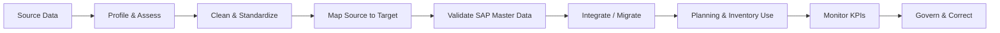
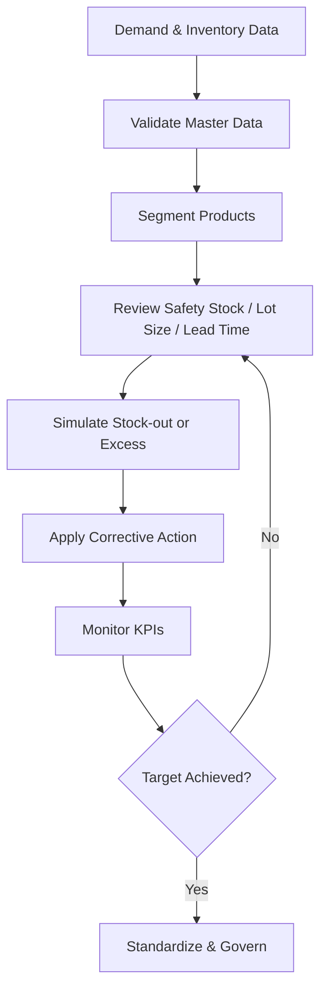

# SAP SCM Master Data & Inventory Optimization

## Week 2 Internship Project

This repository documents a **Master Data Management and Inventory Optimization project using SAP SCM / SAP APO concepts**. It continues the fictional **Deccan Harvest Foods Pvt. Ltd.** scenario used in Week 1 and focuses on improving planning-data quality and inventory performance.

> **Project type:** Internship planning simulation and SAP configuration blueprint. It is not presented as a live production-system implementation.

## Project Objective

The objective is to understand how reliable SAP SCM master data supports better demand planning, procurement, replenishment, and inventory control. The project covers:

- data profiling, cleansing, standardization, and validation
- source-to-target data mapping
- SAP APO master data and CIF integration concepts
- inventory parameters such as safety stock, lot size, lead time, and service level
- stock-out and excess-inventory scenarios
- EOQ, reorder-point, and ABC-XYZ analysis
- KPI monitoring and post-implementation governance

## Business Scenario

The fictional company, **Deccan Harvest Foods Pvt. Ltd.**, produces packaged millet-based ready-to-cook products and serves markets across Telangana, Andhra Pradesh, and Karnataka.

The Week 2 exercise reviews planning-relevant master data for suppliers, products, locations, resources, transportation lanes, sourcing relationships, calendars, lead times, and inventory parameters. The aim is to reduce stock-out risk while avoiding unnecessary excess inventory.

## Master Data Lifecycle



## Inventory Optimization Loop



## SAP SCM / APO Concepts Applied

| Area | Concepts used |
|---|---|
| Product Master | Product, location-product, UoM, lot-size parameters |
| Location Master | Plants, suppliers, distribution centers, customer locations |
| Resource Master | Production, storage, and transport resources |
| Integration | CIF integration-model concepts and validation |
| Sourcing | Production/procurement relationships and quotas |
| Transportation | Transportation lanes, transit times, capacities |
| Inventory | Safety stock, safety days, reorder-point logic, EOQ |
| Segmentation | ABC-XYZ classification |
| Monitoring | Service level, stock-outs, excess inventory, data-quality KPIs |

## Project Approach

1. Identify planning-relevant master data.
2. Profile source data and identify data-quality issues.
3. Clean duplicates, invalid values, and inconsistent formats.
4. Standardize units, naming conventions, lead times, and calendars.
5. Map source fields to SAP SCM/APO target objects.
6. Validate products, locations, resources, and transportation lanes.
7. Review CIF integration-model concepts.
8. Define inventory parameters by product/location.
9. Perform ABC-XYZ segmentation.
10. Evaluate EOQ, safety stock, and reorder-point logic.
11. Simulate stock-out and excess-inventory scenarios.
12. Recommend corrective actions.
13. Monitor inventory and data-quality KPIs.
14. Define governance and change-control responsibilities.

## Practical Scenarios

### Stock-out risk
A transport delay is simulated to test how insufficient buffer stock and longer replenishment lead time can create a shortage. Proposed responses include alternate sourcing, safety-stock review, expedite options, and parameter correction.

### Excess inventory
A demand decline combined with oversized replenishment is simulated to demonstrate excess stock. Proposed responses include lot-size reduction, parameter review, redeployment, and tighter demand/inventory monitoring.

## Key KPIs

- stock-out frequency
- service level / fill rate
- inventory days of supply
- excess and obsolete inventory
- safety-stock coverage
- forecast-versus-consumption variance
- lead-time adherence
- master-data completeness and accuracy
- duplicate/error rate

## Repository Structure

```text
SAP-SCM-Master-Data-Inventory-Optimization/
|
|-- README.md
|-- docs/
|   |-- SAP_SCM_Week2_Master_Data_Inventory_Optimization_Hrudhai_Final_Reviewed.docx
|   |-- master-data-project-plan.md
|   |-- data-mapping-strategy.md
|   |-- inventory-optimization.md
|   `-- submission-description.md
|
`-- diagrams/
    |-- master-data-lifecycle.md
    `-- inventory-optimization-loop.md
```

## Final Report

📄 [**Open the Week 2 Final Report**](docs/SAP_SCM_Week2_Master_Data_Inventory_Optimization_Hrudhai_Final.docx)

## Learning Outcomes

This exercise helped me understand that inventory optimization depends heavily on master-data quality. Incorrect lead times, lot sizes, units of measure, sourcing rules, or safety-stock settings can create shortages or excess inventory even when demand data is available.

The project also strengthened my understanding of how data cleansing, mapping, CIF integration concepts, inventory parameters, segmentation, simulation, and KPI monitoring fit together in SAP SCM planning.

## Author

**Hrudhai Prem Kumar Patwari**  
SAP SCM / SAP MM Learner | IT Operations Professional

---

### Academic / Internship Use

This repository is a learning and internship project. Company names, quantities, lead times, costs, inventory values, and results used in the scenario are fictional and are intended only to demonstrate SAP SCM concepts.


## Six-Assessment Series

This repository is part of the six-assessment SAP SCM internship series. Each assessment keeps the final Word report and supporting analysis under `docs/`, with editable process diagrams under `diagrams/`. See `docs/assessment-overview.md` for the standardized assessment map.
