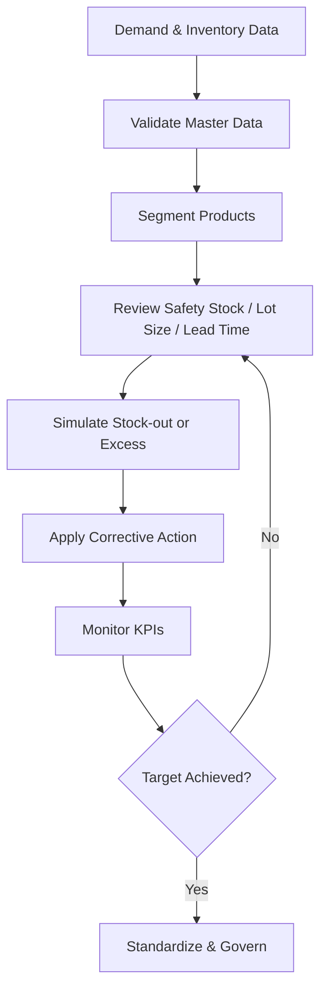

# Inventory Optimization Loop

The loop illustrates how inventory parameters should be reviewed using demand, supply, and data-quality evidence, then monitored after changes rather than treated as fixed values.
