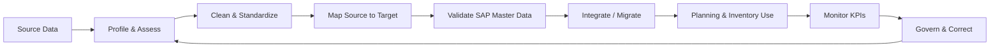

# Master Data Lifecycle

This diagram represents the continuous master-data management cycle used in the Week 2 project. Data quality is treated as an ongoing governance process rather than a one-time migration activity.
